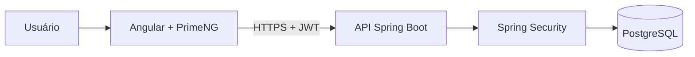

<div align="center">

# 💰 Finora

**Controle financeiro pessoal com segurança levada a sério.**

Registre receitas e despesas, organize por categorias e acompanhe seu saldo, com seus dados protegidos por autenticação JWT, senhas com hash e acesso isolado por usuário.


</div>

---

## 📌 Sobre o projeto

Dados financeiros estão entre as informações mais sensíveis de uma pessoa. Por isso, o Finora foi pensado com **segurança desde a primeira linha de código** (*security by design*), e não como algo adicionado no final.

O projeto também segue práticas de times profissionais: fluxo de branches, commits padronizados, issues e Pull Requests para cada funcionalidade.

---

## ✨ Funcionalidades

### Versão 1
- [ ] Cadastro e login de usuários
- [ ] Registro de receitas e despesas
- [ ] Categorias personalizadas
- [ ] Saldo do mês e total por categoria
- [ ] Isolamento de dados: cada usuário acessa apenas os próprios registros

### Versão 2
- [ ] Metas de economia
- [ ] Gráficos de gastos
- [ ] Despesas fixas recorrentes

---

## 🔐 Segurança

| Prática | Por quê | Status |
|---|---|---|
| Senhas com hash **BCrypt** | Mesmo com vazamento do banco, as senhas não ficam expostas | ⏳ |
| **JWT** com access token de curta duração | Reduz o estrago caso um token seja roubado | ⏳ |
| **Refresh token** com rotação | Mantém o usuário logado sem tokens de vida longa | ⏳ |
| Autorização por perfil (**USER / ADMIN**) | Cada um acessa só o que pode | ⏳ |
| Proteção contra **IDOR** | Um usuário não consegue ler dados de outro trocando o ID na URL | ⏳ |
| **Rate limiting** no login | Dificulta ataques de força bruta | ⏳ |
| Validação de entrada (**Bean Validation**) | Bloqueia dados inválidos ou maliciosos | ⏳ |
| **CORS** restrito | Só o front-end autorizado chama a API | ⏳ |
| Segredos em **variáveis de ambiente** | Nenhuma senha ou chave vai para o repositório | ✅ |

---

## 🏗️ Arquitetura



```
finora/
├── backend/    # API REST (Spring Boot)
└── frontend/   # Aplicação web (Angular)
```

---

## 🧠 Decisões técnicas

Registro das principais escolhas e o motivo de cada uma:

- **Spring Security em vez de autenticação manual:** é o padrão do mercado, testado em produção e mantido pela comunidade. Reinventar segurança é um risco.
- **JWT stateless:** a API não guarda sessão, o que facilita escalar.
- **Monorepo:** back e front no mesmo repositório deixam o histórico de cada funcionalidade completo num só lugar.

---

## 🌿 Fluxo de trabalho

- `main`: código estável
- `develop`: integração das funcionalidades
- `feature/*`: uma branch por funcionalidade, sempre saindo da `develop`

Commits seguem o padrão [Conventional Commits](https://www.conventionalcommits.org/pt-br/):

```
feat: adiciona cadastro de usuário
fix: corrige cálculo do saldo mensal
docs: atualiza README
```

---

## 🚀 Como executar

> Em breve, assim que a primeira versão da API estiver pronta.

---

## 👤 Autor

**José Gabriel**
[GitHub](https://github.com/josegabrielprgm) · [LinkedIn](https://linkedin.com/in/SEU-PERFIL)